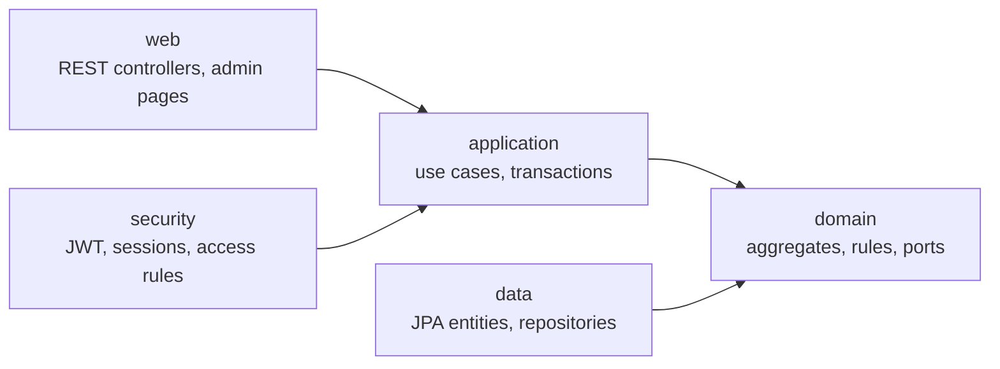

# Passly

[](https://github.com/fedchuk/passly-server/actions/workflows/ci.yml)

Passly is a SaaS backend for restaurants: a REST API for the waiter and kitchen apps, plus a web admin where owners and managers build their menu.

**Live demo:** https://passly-8ece774580f7.herokuapp.com. The app may take about 20 seconds to wake up on the first request.

## What it does

- **Multi-tenant SaaS.** One business (tenant) can own several venues. Every request is checked against the venue in the URL, and data of one business is never visible to another.
- **Menu with unlimited nesting.** Categories form a tree. Items have a price, VAT rate, kitchen or bar station (inherited from the category), a stop list and modifier groups such as doneness or size.
- **Roles per venue.** Owner, manager, waiter and kitchen. A person can be a manager in one venue and a waiter in another.
- **Two ways to sign in.**
    - Mobile apps get a short-lived JWT plus a rotating refresh token.
    - The web admin uses a server session with CSRF protection and remember-me.

## Tech stack

| Area | Technology |
|---|---|
| Language | Kotlin 2.3, Java 21 |
| Framework | Spring Boot 4.1 (Web MVC, Data JPA, Security, Validation, Thymeleaf) |
| Database | PostgreSQL, Flyway migrations, Hibernate 7 |
| Security | Spring Security 7, OAuth2 Resource Server (RS256 JWT), BCrypt |
| Web admin | Thymeleaf, Pico CSS |
| Tests | JUnit 5, MockMvc, Spring Security Test, Testcontainers |
| CI/CD | GitHub Actions → Heroku |

## Architecture

The code follows a layered, hexagonal approach. The domain is plain Kotlin with no Spring or JPA. The other layers depend on it, never the other way round.



```
src/main/kotlin/com/passly
├── domain        aggregates and business rules: MenuTree, CategoryItems, ModifierGroup, User, RefreshToken
├── application   services: one method per use case, transaction boundaries
├── data          JPA entities and repository adapters for the domain ports
├── security      filter chains, JWT, password hashing, venue authorization
├── web/api       REST API for the mobile apps
└── web/admin     server-rendered admin site
```

### Design decisions

- **Always-valid domain.** Aggregates protect their own invariants. For example, a category cannot be moved into its own subtree, and a modifier group cannot require more options than it has. Value classes (`Money`, `TaxRate`, `Email`, typed IDs) are validated on creation.
- **Concurrency.**
    - Optimistic locking (`@Version`) with an expected version sent by the client returns `409 Conflict` instead of silently overwriting someone else's change.
    - Structural changes to a menu, such as reordering, take a pessimistic lock on the venue.
- **Refresh token rotation with reuse detection.** Each refresh replaces the token. Presenting an already used token revokes the whole session family. Only SHA-256 hashes of tokens are stored.
- **Roles live in the database, not in the JWT.** A dismissed manager loses access immediately instead of when the token expires.
- **Two security filter chains.**
    - `/api/**` is stateless: Bearer JWT, no CSRF, `401` as JSON.
    - The site is stateful: session, CSRF, redirect to the login page.
    - Anything not explicitly allowed is denied.
- **Errors as RFC 9457 Problem Details** with field-level validation errors.

## API overview

All endpoints except login and refresh need `Authorization: Bearer <access token>`.

| Method | Path | Purpose |
|---|---|---|
| POST | `/api/v1/auth/login` | Get an access and a refresh token |
| POST | `/api/v1/auth/refresh` | Rotate the refresh token |
| POST | `/api/v1/auth/logout`, `/logout-all` | End one session or all of them |
| GET | `/api/v1/me` | Current user and their venues |
| GET, POST | `/api/v1/venues/{venueId}/categories` | Category tree (with ETag) and creation |
| PUT, DELETE | `/api/v1/venues/{venueId}/categories/{id}` | Update or delete a category |
| POST | `/api/v1/venues/{venueId}/categories/{id}/move` | Move a category in the tree |
| GET, POST | `/api/v1/venues/{venueId}/categories/{id}/items` | Items of a category |
| PUT | `/api/v1/venues/{venueId}/items/{id}/availability` | Stop list |
| PUT | `/api/v1/venues/{venueId}/items/{id}/modifier-groups` | Attach modifier groups |
| GET, POST | `/api/v1/venues/{venueId}/modifier-groups` | Modifier groups |
| GET, POST | `/api/v1/venues/{venueId}/staff` | Staff of a venue |

## Running locally

Requirements: JDK 21 and Docker.

```bash
docker compose up -d
./gradlew bootRun
```

The app starts on http://localhost:8080 and applies the database migrations automatically.

To create the first business and owner, set these variables before starting the app:

```bash
export BOOTSTRAP_BUSINESS_NAME="Demo Group"
export BOOTSTRAP_VENUE_NAME="Demo Bistro"
export BOOTSTRAP_OWNER_EMAIL="owner@example.com"
export BOOTSTRAP_OWNER_NAME="Owner"
export BOOTSTRAP_OWNER_PASSWORD="change-me-please"
```

## Tests

```bash
./gradlew test
```

Over 200 tests:

- **Unit tests** of the domain and services use in-memory fakes.
- **Integration tests** run against a real PostgreSQL in Testcontainers.
- **Web tests** cover the REST API, the admin pages and the security rules with MockMvc.

## Deployment

Every push to `main` runs the tests on GitHub Actions. When they pass, the app is deployed to Heroku and a health check confirms it is up.

Production configuration comes only from environment variables: database, JWT private key, remember-me key. The `prod` profile refuses to start if a secret is missing.

## Roadmap

- Admin pages for modifier groups, staff and platform administration
- Orders from the waiter app and a kitchen display
- Menu change events through Kafka with a transactional outbox
- Kotlin Multiplatform waiter app