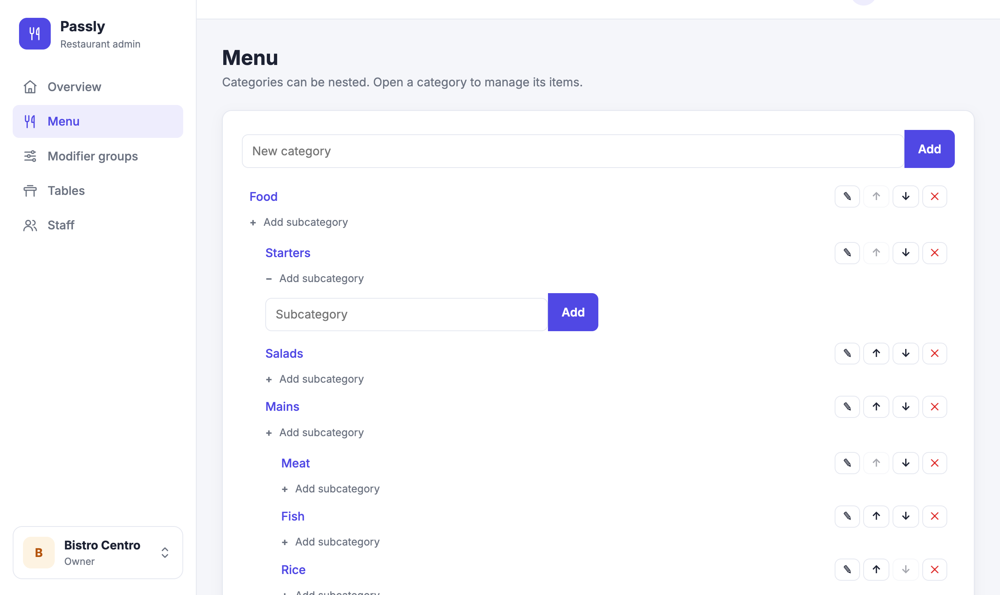
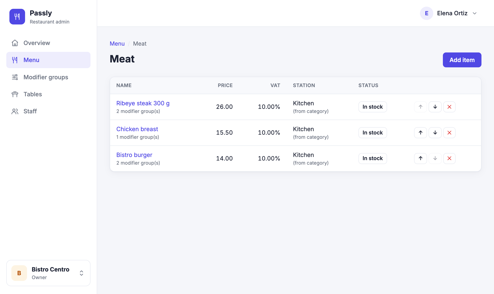
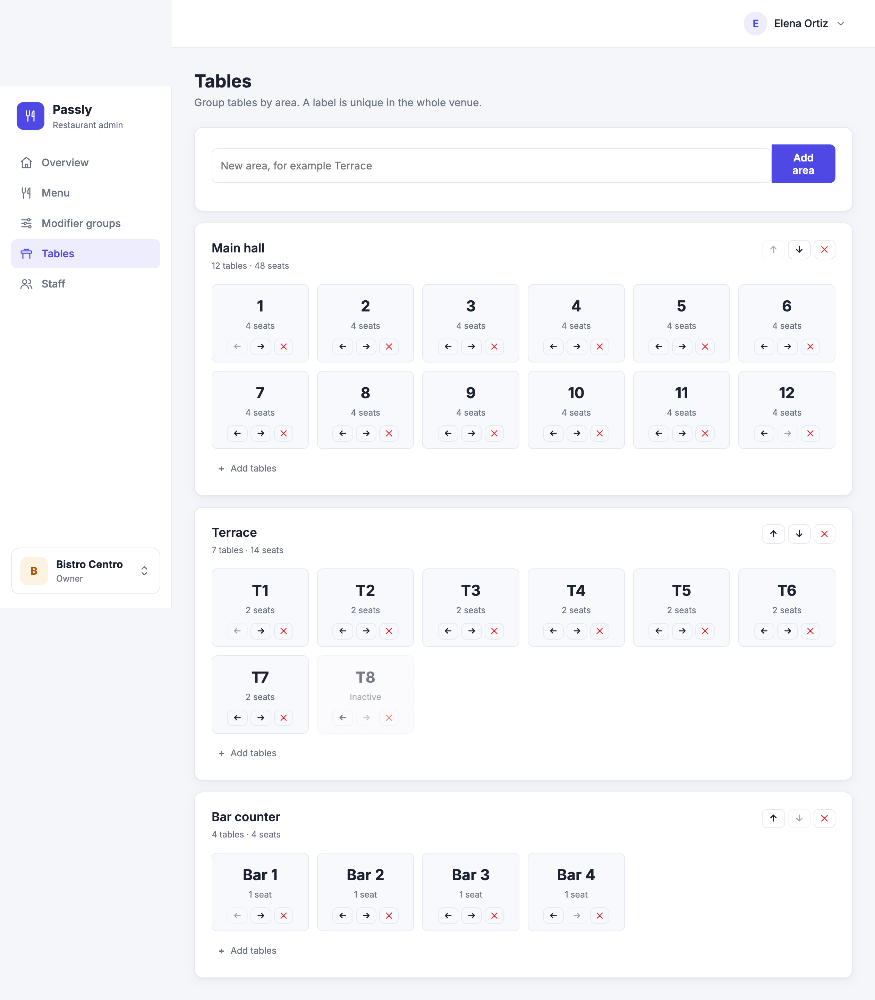
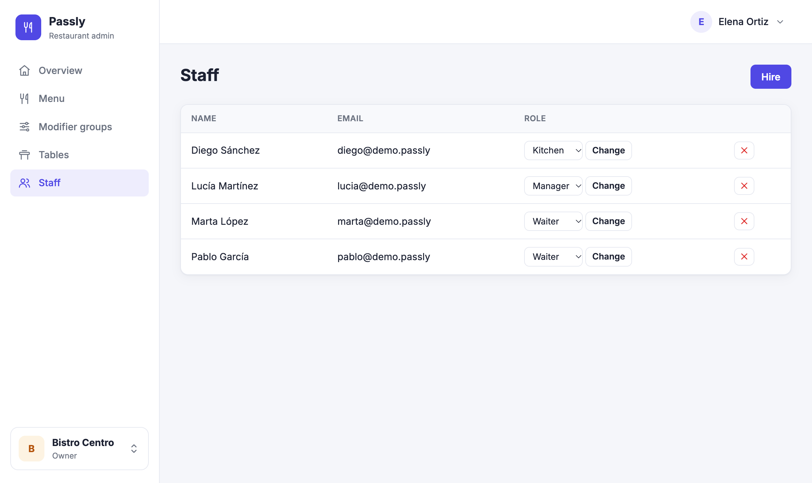
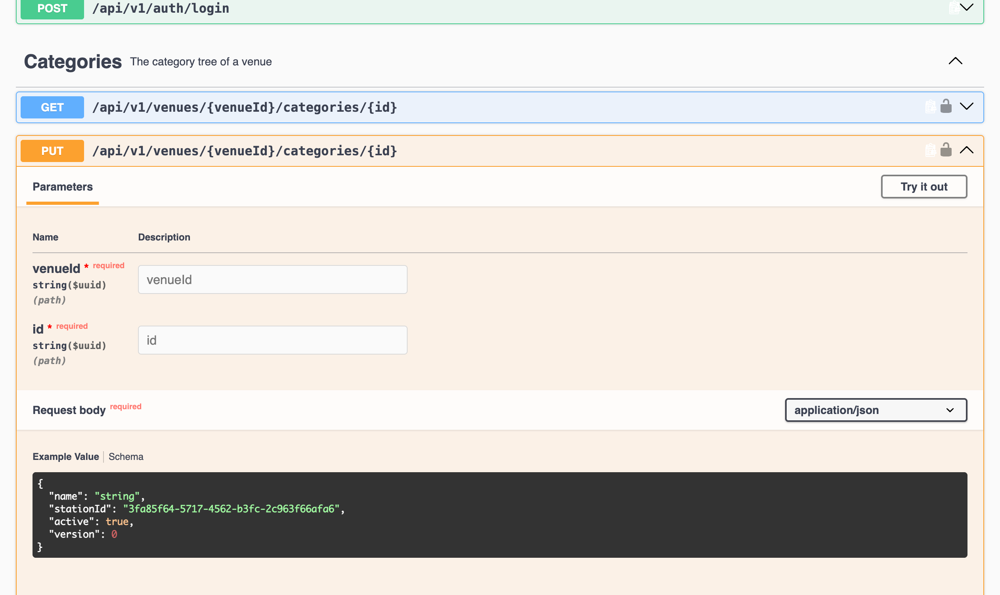
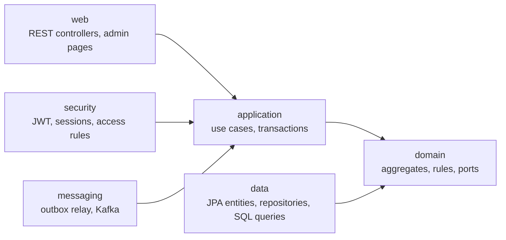

# Passly

[](https://github.com/fedchuk/passly-server/actions/workflows/ci.yml)

Passly is a multi-tenant SaaS backend for restaurants: a REST API for the waiter and kitchen apps, plus a web admin where owners and managers set up their menu, tables and staff.

**Live:** https://passly-8ece774580f7.herokuapp.com (admin login required) · [Swagger UI](https://passly-8ece774580f7.herokuapp.com/swagger-ui.html) · [OpenAPI spec](https://passly-8ece774580f7.herokuapp.com/v3/api-docs)

## Screenshots

| Menu | Menu item |
|---|---|
|  |  |
| **Tables** | **Staff** |
|  |  |



## What it does

- **Multi-tenant SaaS.** One business (tenant) can own several venues. Every request is checked against the venue in the URL, and data of one business is never visible to another.
- **Menu with unlimited nesting.** Categories form a tree. Items have a price, VAT rate, kitchen or bar station (inherited from the category), a stop list and modifier groups such as doneness or size.
- **Areas and tables.** Tables are grouped by area (main hall, terrace) with a label unique in the venue. A whole range such as 1–20 is added in one step.
- **Live updates for the apps.** The menu and the floor are versioned. Clients use ETags to skip unchanged data and a server-sent events stream to learn about menu changes at once.
- **Roles per venue.** Owner, manager, waiter and kitchen. A person can be a manager in one venue and a waiter in another.
- **Two ways to sign in.**
  - Mobile apps get a short-lived JWT plus a rotating refresh token.
  - The web admin uses a server session with CSRF protection and remember-me.

## Tech stack

| Area | Technology |
|---|---|
| Language | Kotlin 2.3, Java 21 |
| Framework | Spring Boot 4.1 (Web MVC, Data JPA, JDBC, Security, Validation, Thymeleaf) |
| Database | PostgreSQL, Flyway migrations, Hibernate 7 |
| Messaging | Transactional outbox, Apache Kafka (optional), server-sent events |
| Security | Spring Security 7, OAuth2 Resource Server (RS256 JWT), BCrypt |
| API docs | springdoc-openapi, Swagger UI |
| Web admin | Thymeleaf, hand-written CSS with a dark theme |
| Tests | JUnit 5, MockMvc, Spring Security Test, Testcontainers (PostgreSQL, Kafka) |
| CI/CD | GitHub Actions → Heroku |

## Architecture

The code follows a layered, hexagonal approach. The domain is plain Kotlin with no Spring or JPA. The other layers depend on it, never the other way round.



```
src/main/kotlin/com/passly
├── domain        aggregates and business rules: MenuTree, CategoryItems, ModifierGroup, FloorPlan, User, RefreshToken
├── application   services: one method per use case, transaction boundaries
├── data          JPA entities, repository adapters and read-only SQL queries
├── messaging     outbox relay and Kafka publisher
├── security      filter chains, JWT, password hashing, venue authorization
├── web/api       REST API for the mobile apps
└── web/admin     server-rendered admin site
```

### Design decisions

- **Always-valid domain.** Aggregates protect their own invariants. A category cannot be moved into its own subtree, a modifier group cannot require more options than it has, and a batch of tables is added only if none of its labels is taken. Value classes (`Money`, `TaxRate`, `Email`, typed IDs) are validated on creation.
- **Concurrency.**
  - Optimistic locking (`@Version`) with an expected version sent by the client returns `409 Conflict` instead of silently overwriting someone else's change.
  - Structural changes, such as reordering the menu or adding tables, take a pessimistic lock on the venue.
  - Database constraints back up the domain rules, for example a case-insensitive unique index on table labels.
- **Transactional outbox.** A menu change and its event are written in one transaction. A relay publishes the events to Kafka, or in-process when Kafka is turned off, so an event is never lost or sent for a change that was rolled back.
- **Read models.** The waiter menu is built with plain SQL in one repeatable-read transaction instead of loading JPA aggregates.
- **Refresh token rotation with reuse detection.** Each refresh replaces the token. Presenting an already used token revokes the whole session family. Only SHA-256 hashes of tokens are stored.
- **Roles live in the database, not in the JWT.** A dismissed manager loses access immediately instead of when the token expires.
- **Two security filter chains.**
  - `/api/**` is stateless: Bearer JWT, no CSRF, `401` as JSON.
  - The site is stateful: session, CSRF, redirect to the login page.
  - Anything not explicitly allowed is denied.
- **Errors as RFC 9457 Problem Details** with field-level validation errors.

## API

Interactive documentation: [Swagger UI](https://passly-8ece774580f7.herokuapp.com/swagger-ui.html) · [OpenAPI spec](https://passly-8ece774580f7.herokuapp.com/v3/api-docs)

How the API works:

- **Authentication.** `POST /api/v1/auth/login` returns a short-lived access token (15 minutes) and a refresh token. Send the access token as `Authorization: Bearer <token>`. When it expires, call `POST /api/v1/auth/refresh` to get a new pair; each refresh token works only once.
- **Everything is scoped to a venue:** `/api/v1/venues/{venueId}/...`. What you can do there depends on your role in that venue.
- **Keeping data fresh.** `GET .../menu` and `GET .../floor` return an `ETag` with the current version. Send it back in `If-None-Match` to get an empty `304` while nothing changed. For instant menu updates, keep `GET .../menu/events` open: a server-sent events stream that reports every new menu version.
- **Optimistic locking.** Updates carry the `version` you last read. If someone changed the resource in between, you get `409 Conflict`.
- **Errors** use RFC 9457 Problem Details, with field errors for validation failures.
- **Money** is sent as strings (`"4.50"`) to avoid floating point errors.

```bash
curl -X POST https://passly-8ece774580f7.herokuapp.com/api/v1/auth/login \
  -H 'Content-Type: application/json' \
  -d '{"email": "owner@example.com", "password": "..."}'
```

## Running locally

Requirements: JDK 21 and Docker.

```bash
docker compose up -d
./gradlew bootRun
```

The app starts on http://localhost:8080 and applies the database migrations automatically.

### Demo restaurant

To fill a local database with a demo restaurant (nested menu with modifiers and a stop list, three areas with tables, and staff in every role), start with the `demo` profile:

```bash
DEMO_PASSWORD='pick-a-password' ./gradlew bootRun --args='--spring.profiles.active=demo'
```

Log in as `owner@demo.passly` with that password. Without `DEMO_PASSWORD`, a random password is generated and printed in the log. The profile never runs together with `prod`, and it does nothing if the demo owner already exists. To start over, run `docker compose down -v`.

### Your own business

To create the first business and owner, set these variables before starting the app:

```bash
export BOOTSTRAP_BUSINESS_NAME="Demo Group"
export BOOTSTRAP_VENUE_NAME="Demo Bistro"
export BOOTSTRAP_OWNER_EMAIL="owner@example.com"
export BOOTSTRAP_OWNER_NAME="Owner"
export BOOTSTRAP_OWNER_PASSWORD="change-me-please"
```

To create a platform admin, who sees every business at `/platform` and can add new ones:

```bash
export PLATFORM_ADMIN_EMAIL="admin@example.com"
export PLATFORM_ADMIN_PASSWORD="change-me-please"
```

Both bootstraps run on startup and do nothing if the user already exists.

To publish menu events to Kafka instead of in-process, start Kafka from `docker-compose.yml` and set `KAFKA_ENABLED=true`.

## Tests

```bash
./gradlew test
```

Over 300 tests:

- **Unit tests** of the domain and services use in-memory fakes.
- **Integration tests** run against real PostgreSQL and Kafka in Testcontainers.
- **Web tests** cover the REST API, the admin pages and the security rules with MockMvc.

## Deployment

Every push to `main` runs the tests on GitHub Actions. When they pass, the app is deployed to Heroku and a health check confirms it is up.

Production configuration comes only from environment variables: database, JWT private key, remember-me key. The `prod` profile refuses to start if a secret is missing.

## Roadmap

- Orders from the waiter app, with server-side stop-list checks
- Kitchen and bar display
- Kotlin